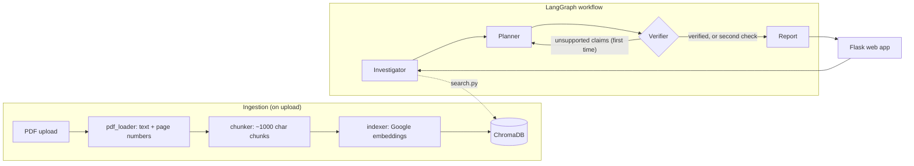

# EngiGraph

A controlled multi-agent assistant that reads equipment manuals, retrieves cited evidence, and produces a **verified diagnostic report** with explicit uncertainty and safety notes.

> **Safety:** EngiGraph is decision support, not an autonomous machine controller. It never executes equipment commands and never presents unverified procedures as safe instructions. Always confirm against the original manual.

<!-- Add your demo here:  or a YouTube link -->

## What it does

1. You upload equipment manuals (PDF).
2. You describe a problem ("excessive vibration after startup").
3. Three agents work in a fixed, auditable order and produce a report where **every claim cites a document and page**. Anything the manuals do not support is flagged `UNVERIFIED`, and if the documents do not cover the problem the system says so instead of guessing.

## Architecture



| Agent | Responsibility | Guardrail in code |
|---|---|---|
| **Investigator** | Retrieves passages, extracts possible causes | Findings citing a page that was never retrieved are dropped |
| **Planner** | Turns findings into ordered, non-intrusive checks | Steps without a retrieved citation are tagged `[Not backed by manuals]` |
| **Verifier** | Checks every claim against the cited passage; may request **one** revision | Revision counter lives in state, so the loop cannot run forever |
| **Report** | Formats the final Markdown report | Plain Python, no LLM: always includes safety notes and uncertainty |

Shared state is limited to six keys: `user_query`, `retrieved_chunks`, `findings`, `diagnostic_plan`, `verification_result`, `final_report`. It is a **controlled workflow**, not agents chatting freely.

## Engineering decisions worth knowing

- **Structured output + retry.** Agents return validated Pydantic objects. LLMs occasionally emit broken tool-call JSON, so `invoke_structured` retries with a slightly higher temperature (identical retries at temperature 0 repeat the same mistake).
- **Rate limits are a design constraint.** Three LLM calls per question hit free-tier tokens-per-minute limits, so prompts are trimmed, replies are capped, indexing is batched and resumable, and the web app runs one diagnosis at a time in a background job.
- **Evaluation is resumable and honest.** Results are stored per question; failed or quota-limited runs are re-run later; systems are compared only on questions **both** completed.
- **Deterministic report.** The final report is not LLM-written, so safety notes can never be skipped.

## Tech stack

Python, LangGraph, LangChain, Groq (hosted LLM), Google embeddings API, PyMuPDF, ChromaDB, Pydantic, Flask, pandas, pytest.

## Quickstart

```bash
git clone <your-repo-url> && cd engigraph
python -m venv venv
venv\Scripts\activate            # macOS/Linux: source venv/bin/activate
pip install -r requirements.txt
cp .env.example .env             # then put your real keys in .env
```

`.env`:

```
GROQ_API_KEY=...
GROQ_MODEL=...                   # run: python main.py list-models
GOOGLE_API_KEY=...
```

Put one or more text-based PDFs in `data/raw_pdfs/` (use documents you are allowed to use; none are included in this repo), then:

```bash
python main.py index                      # build the vector index
python main.py serve                      # web app at http://127.0.0.1:5000
python main.py diagnose "Motor vibrates excessively after startup" --save
python main.py ask "What checks does the manual list for bearing wear?"   # baseline RAG
```

Example problems to try: "Performance degradation observed over time", "Abnormal temperature rise in the unit". Also try one the manuals do **not** cover; the correct result is `NO EVIDENCE`.

## Evaluation

The benchmark (`data/evaluation_questions.json`) contains questions I wrote and verified by hand against the PDFs: single-page, multi-passage and **unanswerable** questions. The multi-agent workflow is compared with a single-call RAG baseline using the same LLM and the same retrieval depth.

```bash
python main.py eval-check        # validate the dataset
python main.py eval-run          # resumable; safe to stop and re-run
python main.py eval-readme       # refresh the table below
```

<!-- RESULTS:START -->
_No results yet. Run `python main.py eval-run`, then `python main.py eval-readme`._
<!-- RESULTS:END -->

**Reading the numbers:** accuracy is graded by an LLM judge against my verified answers (so it can be lenient); retrieval recall is shared by both systems and caps what either can cite; with a small question set, differences of a few points are noise.

## Project structure

```
app/            Flask app (routes, templates, static)
src/ingestion/  pdf_loader, chunker, indexer
src/retrieval/  search
src/agents/     investigator, planner, verifier
src/workflow/   state, graph (LangGraph)
src/services/   llm, basic_rag, report
src/evaluation/ dataset, metrics, judge, runner, summary, retrieval, draft
tests/          offline tests (LLM and search are faked)
```

```bash
python -m pytest -q tests/       # no API calls, no cost
```

## Limitations

- **Retrieval is the weak link.** Both systems share one retriever; if the right page is not retrieved, no agent can cite it. Improving retrieval (hybrid search, re-ranking, larger k) is the highest-value next step.
- Evaluation uses an LLM judge from the same model family and a small, single-author question set.
- Free-tier API quotas limit throughput; a full evaluation may take several days.
- Text-based PDFs only (no OCR); tables and figures are not understood.
- Not safety-certified and not for use on live equipment decisions.

## Roadmap

Retrieval improvements, OCR for scanned manuals, a second LLM for independent verification, FastAPI service, and sensor-data integration (predictive maintenance) only after the core is solid.

## Documents and licensing

No manuals are redistributed. Check each document's terms before sharing it (NASA NTRS reports and manufacturer manuals have different reuse terms).
